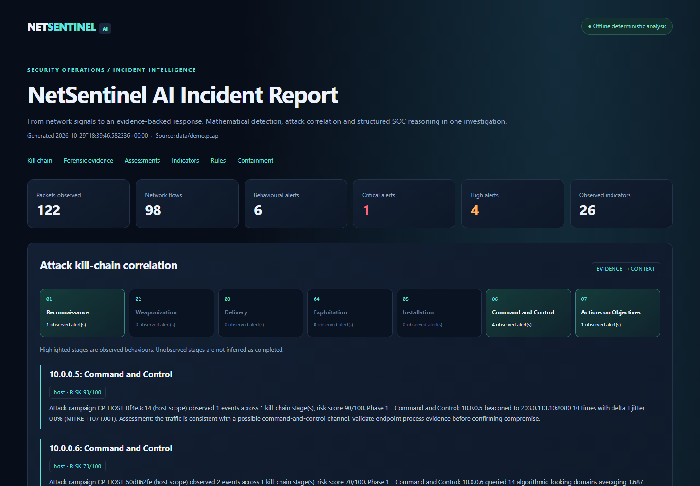
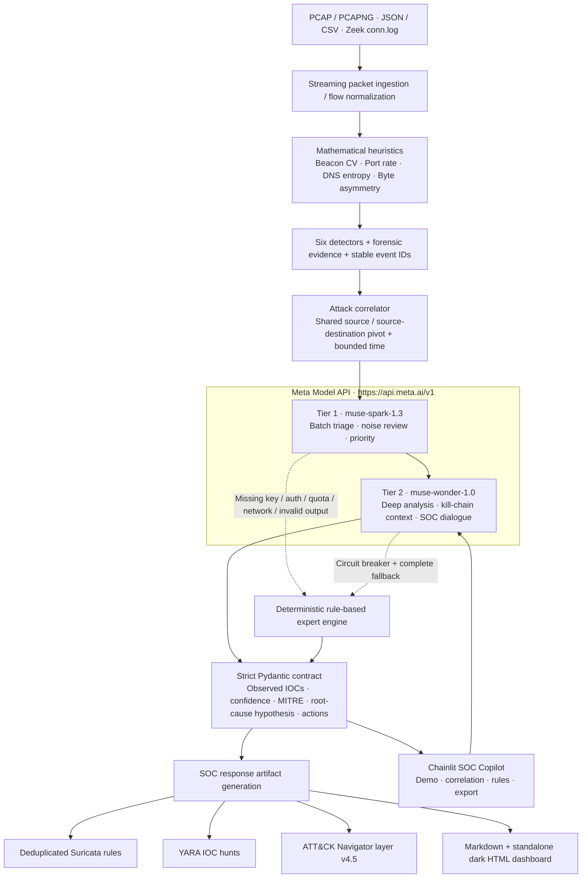

# NetSentinel AI

### Turn network evidence into a defensible SOC decision.

[](https://dev.meta.ai/models/muse-wonder)
[](https://dev.meta.ai/models/muse-spark)
[](examples/attck_navigator_layer.json)
[](examples/suricata_netsentinel.rules)
[](examples/yara_netsentinel.yar)
[](pyproject.toml)
[](https://github.com/Khanhslee/netsentinel-ai/actions/workflows/tests.yml)
[](LICENSE)

**Meta Global AI Developer Hackathon · Track: Push the Frontier**

[View the incident report](examples/sample_incident_report.md) · [Download the standalone dashboard](examples/sample_incident_report.html) · [Inspect structured evidence](examples/sample_detection_report.json) · [Load the ATT&CK layer](examples/attck_navigator_layer.json)

## Executive pitch

SOC analysts face alert fatigue: hundreds of isolated signals, little context, and too much time spent translating evidence into response. NetSentinel AI turns PCAP and flow metadata into a prioritized investigation, with measurable evidence, an attack timeline, and reviewable detection and containment artifacts.

Its hybrid architecture combines **mathematical heuristics + Meta Muse dual-model reasoning**. Local detectors establish what happened in the traffic. **Muse Spark (`muse-spark-1.3`)** batches triage, identifies likely noise and ranks urgency. **Muse Wonder (`muse-wonder-1.0`)** interprets the evidence and correlated activity, explains alternative root causes, maps ATT&CK techniques, and answers the SOC analyst's questions. Analysts can trace every alert back to entropy, inter-arrival variation, port rate or byte counters.

The frontier is the complete investigation workflow: signals become a correlated, explainable decision and portable SOC artifacts. When an API is unavailable, a deterministic expert engine produces the same structured contract, with explicit offline provenance. The demo requires no credentials or network access.



## Architecture



**Evidence and reasoning remain distinct.** A shared source and nearby timestamps support a correlation hypothesis. A source/destination pivot may link hosts; a shared public resolver alone does not. Capture-wide context is shown separately and is not counted as a confirmed campaign. The actual timeline is preserved even when the framework's kill-chain stages have a different order.

## See the results before running anything

| Artifact | What judges can inspect |
| --- | --- |
| [Structured detection report](examples/sample_detection_report.json) | All six alerts, measured features, structured assessments, provenance and timelines |
| [Markdown incident report](examples/sample_incident_report.md) | Executive assessment, forensic tables, IOCs, rules and response playbook |
| [Standalone HTML dashboard](examples/sample_incident_report.html) | Dark dashboard, six KPIs, kill-chain visualization, analyst reasoning and Copy buttons |
| [ATT&CK Navigator layer](examples/attck_navigator_layer.json) | Five unique techniques, severity scores, red/orange overlays and evidence comments |
| [Suricata rules](examples/suricata_netsentinel.rules) | Six source-scoped IOC/behaviour watch rules, SIDs `9000001`–`9000006` |
| [YARA rules](examples/yara_netsentinel.yar) | Six observed-indicator hunts with author, date, severity and ATT&CK metadata |

GitHub displays HTML source. Download `sample_incident_report.html` and open it locally for the interactive dashboard; it contains all CSS and JavaScript and makes no external requests. Import the Navigator JSON as an existing layer in [ATT&CK Navigator](https://mitre-attack.github.io/attack-navigator/).

## Benchmark & forensic metrics

Reproducible fixture: [`data/demo.pcap`](data/demo.pcap), generated by [`scripts/generate_demo_pcap.py`](scripts/generate_demo_pcap.py). The checked-in results use **offline deterministic reasoning**, so every judge can reproduce them without API credit.

**122 IPv4 packets · 98 flow/DNS observation records · 639-second capture · 6 alerts · 5 source-host groups · 5 ATT&CK techniques · 6 Suricata rules · 6 YARA rules.** Severity: **1 Critical / 4 High / 1 Medium**.

| Scenario | Measured forensic evidence | Severity | ATT&CK | Result |
| --- | --- | --- | --- | --- |
| C2 beacon | 10 sessions; mean Δt **60 s**; CV **0.0000**, jitter **0%** | Critical | `T1071.001` | Detected |
| Port scan | **40** ports in **3.9 s**; **10.26 packets/s** | High | `T1046` | Detected |
| NXDOMAIN storm | **15** distinct failed names across 15 families; **100%** of observed DNS responses fail | High | `T1568.002` | Detected |
| DGA | **14** domains cross the threshold; mean entropy **3.687 bits/character**, maximum **3.948** | High | `T1568.002` | Detected |
| DNS tunneling | **12 TXT queries**; longest label **30** characters; mean subdomain entropy **4.237 bits/character** | High | `T1071.004` | Detected |
| Possible exfiltration | **1,500,000 outbound bytes**, zero reply bytes; guarded upload ratio **1,500,000:1** | Medium | `T1041` | Detected |

The byte-ratio denominator is `max(1, received_bytes)`; the fixture's zero reply bytes do not establish a real finite upload/download ratio or prove data theft. The demo exercises **6/6 attack classes**, not a labeled real-world accuracy benchmark. Confidence values are heuristic evidence scores, not calibrated probabilities. The fixture contains independent host scenarios; its global kill-chain view does not claim a single attacker.

## Quick start

Requires **Python 3.11+**. No capture privileges are needed to read the included fixture.

```bash
git clone git@github.com:Khanhslee/netsentinel-ai.git
cd netsentinel-ai
python -m venv .venv
```

Activate the environment:

```powershell
# Windows PowerShell
.venv\Scripts\Activate.ps1
```

```bash
# macOS / Linux
source .venv/bin/activate
```

Install and run the complete offline demo:

```bash
python -m pip install -e ".[dev]"
python -m netsentinel analyze data/demo.pcap --offline --rules
python -m pytest -q
```

Export all six deliverables with one cross-platform command:

```bash
python -m netsentinel analyze data/demo.pcap --offline --output examples/sample_detection_report.json --report-md examples/sample_incident_report.md --report-html examples/sample_incident_report.html --mitre-layer examples/attck_navigator_layer.json --suricata-rules examples/suricata_netsentinel.rules --yara-rules examples/yara_netsentinel.yar
```

Additional inputs and machine-readable stdout:

```bash
netsentinel analyze capture.pcapng --format json
netsentinel analyze flows.json --offline --report-html incident.html
netsentinel analyze conn.log --offline --config config/config.yaml
python scripts/generate_demo_pcap.py data/demo.pcap
```

CSV/JSON accepts flow aliases such as `src_ip` / `src` / `id.orig_h`, byte/packet counters, start/end time or duration, and optional DNS fields. Zeek input is `conn.log`; it cannot provide DNS content absent from that file.

## Enable Meta Muse reasoning

Copy `.env.example` to `.env` and set a key provisioned in the [Meta developer console](https://dev.meta.ai/). `.env` is ignored by Git.

```dotenv
META_API_KEY=your_key
META_BASE_URL=https://api.meta.ai/v1
META_TRIAGE_MODEL=muse-spark-1.3
META_REASONING_MODEL=muse-wonder-1.0
META_TIMEOUT=20
```

**Key precedence:** `META_API_KEY` → `MODEL_API_KEY` → `LLAMA_API_KEY`. Environment variables override [`config/config.yaml`](config/config.yaml); built-in defaults apply last. Legacy key names remain compatible with the official Meta endpoint.

```bash
# Omit --offline to enable Spark + Wonder when a key is configured.
netsentinel analyze data/demo.pcap --rules
```

The OpenAI-compatible Python SDK connects to the Meta endpoint. Both analysis tiers request strict JSON Schema outputs and validate them with Pydantic: `threat_summary`, `kill_chain_stage`, `mitre_tactic`, `mitre_technique_id`, `confidence_score` in `[0,1]`, typed IOCs, `root_cause_analysis` and `recommended_actions`. Absent hashes, JA3 fingerprints or user agents remain empty; they are never invented from packet timing.

Spark triages detector-selected flow evidence in bounded batches. High-confidence noise decisions can skip expensive Wonder enrichment for lower-severity alerts while preserving the original alert and a complete local assessment. Critical/High evidence remains available for deep analysis. Wonder receives correlated context as hypotheses and supports free-form SOC dialogue.

Missing keys, HTTP 401/403/429, quota errors, network failures, refusals and malformed/incomplete outputs activate a per-analysis circuit breaker. The remaining work uses the deterministic engine, including MITRE mapping, feature-driven interpretation, benign alternatives and response guidance. Reports identify the actual reasoning source and the requested model. API failures do not remove detector findings; configuration and input-file errors still produce actionable CLI errors.

Official references: [Meta Model API overview](https://dev.meta.ai/docs/overview) · [Structured outputs](https://dev.meta.ai/docs/structured-output).

## Chainlit SOC Copilot

```bash
python -m pip install -e ".[ui]"
chainlit run src/netsentinel/ui/app.py
```

The welcome screen shows **Meta Muse Wonder (`muse-wonder-1.0`) + Muse Spark (`muse-spark-1.3`)** and distinguishes a configured key from a verified successful call. Four one-click actions drive the investigation:

1. **🔍 Run Full Demo PCAP Analysis** — open the included fixture automatically.
2. **🔗 View Attack Kill-Chain Correlation** — inspect host groups, pivots and chronology.
3. **🛡️ Generate Suricata & YARA Rules** — inspect and download generated rules.
4. **📊 Export HTML & Markdown SOC Report** — download the dashboard, Markdown and Navigator layer.

Visible steps cover ingestion, detection/correlation/reasoning, and artifact preparation. Analysts can upload their own captures or ask questions such as `explain 1`, `show IOCs`, or a free-form investigation question. Blocking analysis runs off the UI event loop. A terminal interface is also available:

```bash
python -m netsentinel.ui.terminal
```

## Validation and operational scope

The **45-test suite** preserves the original 18 tests and adds coverage for dual-model routing, auth/quota/network fallback, strict malformed-output handling, IOC integrity, correlation windows/pivots, report escaping, Navigator mappings, reply-byte accounting, CLI exports and UI actions. CI runs offline on Python 3.11 and 3.12.

YARA artifacts were compiled with the native YARA library. Suricata generation is unit-tested for structure, escaping, deduplication, protocol selection and SID allocation; engine validation should be run on the target Suricata installation:

```bash
suricata -T -c /etc/suricata/suricata.yaml -S examples/suricata_netsentinel.rules
python -m pip install yara-python
python -c "import yara; yara.compile(filepath='examples/yara_netsentinel.yar'); print('YARA rules compile')"
```

Suricata rules are compact IOC/behaviour watches, not equivalent implementations of the statistical detectors. DNS rules group observed domains into bounded patterns; the full indicator inventory remains in the reports. TCP session watches can require established traffic; the synthetic fixture intentionally includes partial conversations. Review and tune before deployment. YARA searches files/memory for observed strings and does not identify a malware family by itself.

Current packet ingestion supports IPv4; session orientation follows the first observed packet, and non-DNS packets sharing a five-tuple are aggregated for the capture. Midstream captures can invert apparent upload direction. Packet records are streamed, while flow state and the analysis remain memory-resident. Registered-domain grouping uses the last two labels rather than a public-suffix database. Thresholds require local baselining; encrypted payloads and missing endpoint telemetry limit attribution. ATT&CK mappings intentionally target v15 for this submission. Live Meta responses require account/model access and were validated here through mocked SDK contracts rather than a paid API run.

Containment commands for Linux `iptables` / `ip6tables` and Windows `netsh` include rollback guidance and are exported for analyst review. NetSentinel never executes them. Use traffic you own or are authorized to investigate.

## Project map

```text
config/                  Detection thresholds and dual-model configuration
data/demo.pcap           Tracked synthetic fixture
examples/                Six ready-to-review SOC deliverables
scripts/                 Reproducible PCAP generator
src/netsentinel/
  ingest/                Streaming PCAP and flow metadata adapters
  features/              Six mathematical detectors and forensic measurements
  engine/                Detection orchestration and kill-chain correlation
  llm/                   Meta routing, strict schemas and deterministic reasoning
  response/              Suricata, YARA, Navigator, reports and playbooks
  ui/                    Chainlit copilot and terminal chat
  pipeline.py            End-to-end analysis and observable provenance
  cli.py                 Analysis and artifact export commands
tests/                   Regression, unit and integration validation
```

## License

[MIT](LICENSE) · Copyright © 2026 Khanhslee.
